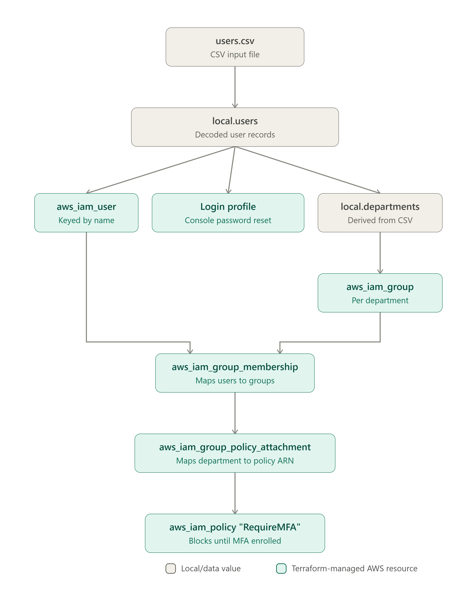
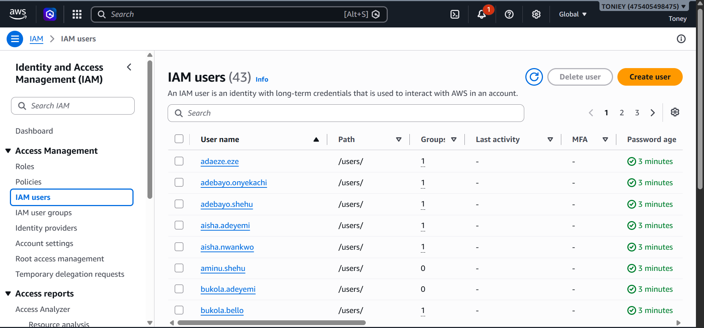
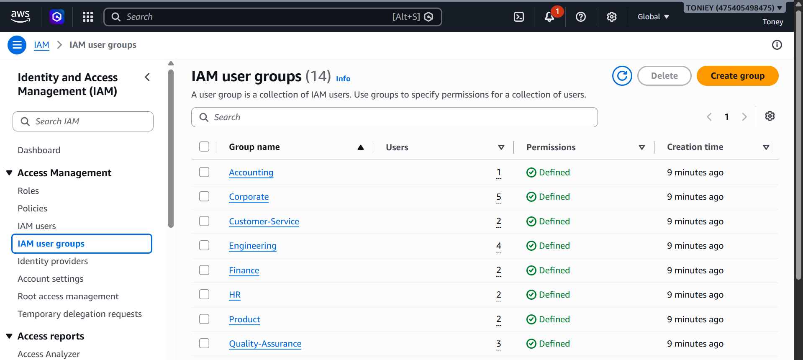
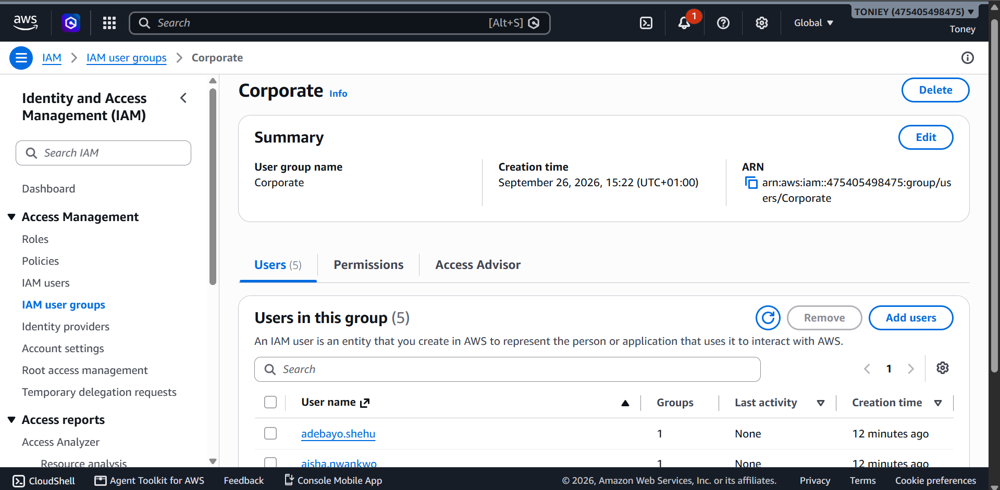
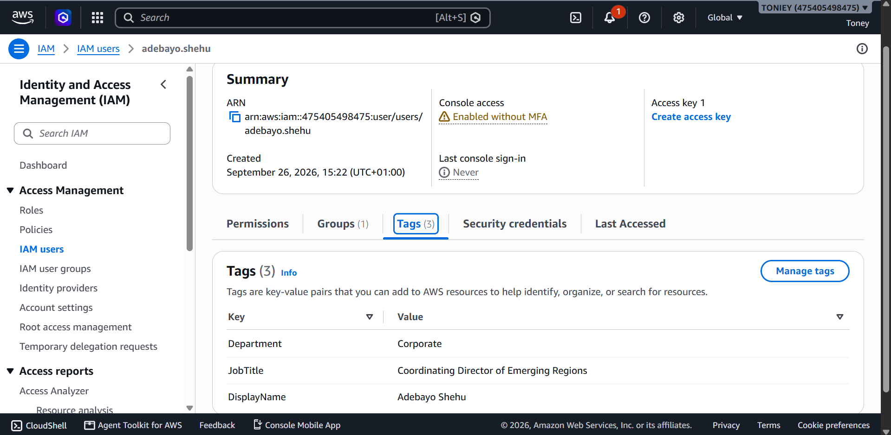
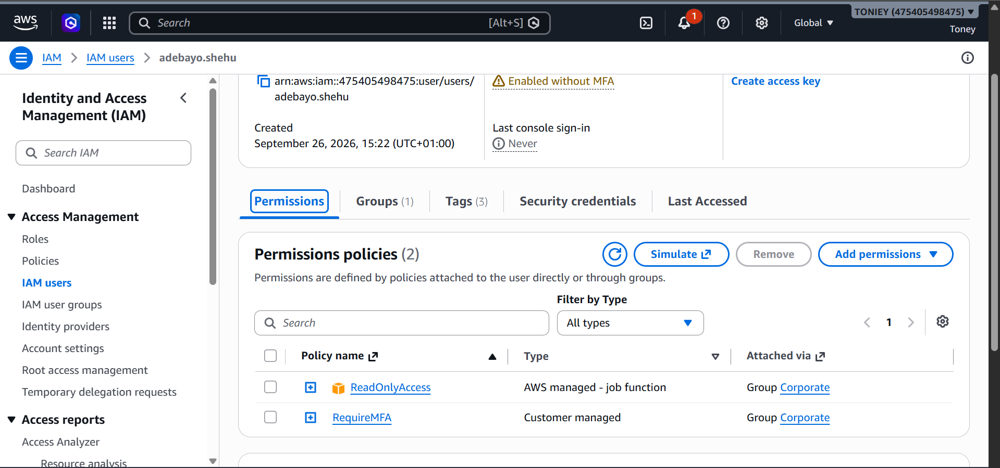

# CSV-Driven IAM User Onboarding (Terraform)

## Overview
Automated AWS IAM user provisioning driven entirely by a CSV file. Adding, removing, or changing a row in `users.csv` and re-running `terraform apply` creates or updates the corresponding IAM user, console login profile, department-based group membership, and attached permissions — no manual IAM console work per employee.

## What This Solves

Onboarding employees through the IAM console one at a time doesn't scale, and it fails in predictable ways:

- **Slow, repetitive setup.** Every new hire means creating a user, setting a password, picking a group, and attaching policies by hand. With 43 employees that is hundreds of console clicks, repeated for every hire after.
- **Inconsistent permissions.** Two people in the same department end up with different access depending on who set them up and when. Nobody can say with confidence what a given role is supposed to have.
- **No record of who has what.** Console changes leave no reviewable history. There is no file to diff, no pull request, and no single place to answer "why does this person have this access?"
- **MFA left optional.** Without enforcement, MFA depends on each user choosing to enable it. Accounts without it are the easiest way into an AWS account.
- **Long-lived shared passwords.** Admin-set passwords get sent over chat or email and often never change.

This project replaces all of that with one CSV file and one `terraform apply`. Access is defined per department in code, every change is reviewable in Git, MFA is enforced for everyone, and no admin-set password survives a user's first login.

## Architecture



## How It Works

1. **`users.csv`** is the single source of truth — one row per employee (name, department, job title, email, phone).
2. **`locals.users`** decodes the CSV into a list Terraform can loop over.
3. **`aws_iam_user`** creates one IAM user per row. Each user is tracked in Terraform under a stable `first_name-last_name` key, so adding or removing a row never shifts other users, and the IAM username is the lowercased `firstname.lastname`. Department and job title are stored as tags for auditability.
4. **`aws_iam_user_login_profile`** generates a console password for each user with `password_reset_required = true` — nobody uses a Terraform-generated password long-term; everyone sets their own on first login.
5. **`aws_iam_group`** creates one group per unique department found in the CSV — departments aren't hardcoded, they're derived from the data. Department names containing spaces (e.g. "Quality Assurance") are sanitized to hyphens for AWS naming compliance.
6. **`aws_iam_group_membership`** assigns each user to the group matching their `Department` tag.
7. **`aws_iam_group_policy_attachment`** attaches department-appropriate permissions — e.g. broader access for Engineering, read-only for most other departments — via a `department -> policy ARN` map.
8. **`aws_iam_policy "RequireMFA"`**, attached to every group, blocks all actions except MFA self-enrollment until the user sets up multi-factor authentication themselves.

## Prerequisites

- AWS CLI configured with a named profile
- Terraform >= 1.0
- `users.csv` present with columns: `first_name, last_name, department, job_title, email, phone_number`

## Deployment

```bash
terraform init
terraform plan
terraform apply
```

## Onboarding a New Employee

Add a row to `users.csv`, then:

```bash
terraform plan
terraform apply
```

Terraform will create exactly the new user, their login profile, and their group membership — no changes to existing users.

## Proof of Work

**All 43 IAM users provisioned from the CSV, each auto-tagged and grouped:**


**14 department groups created automatically from `local.departments`:**


**Corporate group membership — users correctly assigned by department:**


**User tags populated directly from the CSV row (Department, JobTitle, DisplayName):**


**Permissions correctly inherited through group membership — ReadOnlyAccess and RequireMFA both attached via the Corporate group, not set per-user:**


## Design Decisions

**Why a CSV file as the source of truth, not Terraform variables or a database:**
HR and team leads already keep staff lists in spreadsheets. A CSV can be edited by someone who doesn't know Terraform, reviewed line by line in a pull request, and exported from almost any HR system. `csvdecode()` reads it natively, so no extra tooling or data store is needed.

**Why departments are derived from the data, not hardcoded:**
`local.departments` is built from the distinct values in the CSV. When a new department appears, its group is created on the next apply; when the last person leaves one, the group is removed. There is no second list to keep in sync with the CSV, so the two can never drift.

**Why `for_each` keyed on names, not `count`:**
With `count`, users are tracked by row position. Inserting or deleting a row shifts every index after it, and Terraform would destroy and recreate users who never changed. Keying on a stable name means each user is tracked by identity, so only the row that changed produces a change.

**Why the Terraform key and the IAM username are different:**
The `for_each` key (`first_name-last_name`) only needs to be unique and stable inside Terraform. The IAM username (`firstname.lastname`, lowercased) is what people actually type at login, so it follows a conventional, readable format. Keeping them separate means the login format can change without disturbing how Terraform tracks each user.

**Why department names are sanitized only at the point of use:**
`replace(each.value, " ", "-")` is applied only where AWS requires it, in the group name. The original string, such as `"Quality Assurance"`, is kept everywhere else (tags, filtering, membership lookups), so tags stay human-readable and lookups match the CSV exactly.

**Why one membership resource per department, not per user:**
`aws_iam_group_membership` owns a group's entire member list. One resource per group is the only arrangement where each list has a single owner and applies are predictable (see Issue 3 below).

**Why AWS managed policies as the starting point:**
`ReadOnlyAccess` and `PowerUserAccess` are maintained by AWS and kept current as services change. They give a working, auditable baseline immediately; custom least-privilege policies per job function are the planned next step, not a day-one requirement.

**Why IAM users here, and Identity Center as a separate project:**
IAM users and groups show the underlying mechanics directly: users, groups, policies, and MFA enforcement. IAM Identity Center is the right production model, but it replaces the access model rather than extending it, so it belongs in its own repository.

## Security Design Decisions

**Why `password_reset_required = true`, not a distributed password:**
Terraform-generated passwords would need to be securely delivered to each user somehow (Secrets Manager, email, etc.) and would sit in Terraform state either way. Forcing a reset on first login means no real password ever needs to be stored or transmitted after creation.

**Why department-based groups instead of per-user policies:**
Scales correctly — permissions are defined once per department, not once per employee. Onboarding someone new means adding a CSV row and letting the existing department policy apply automatically, not writing new IAM policy from scratch per hire.

**Why MFA enforcement is a Deny-by-default policy, not a suggestion:**
IAM has no built-in "require MFA" toggle at the account level for IAM users (unlike SSO/Identity Center). The standard workaround is a policy that denies nearly everything unless `aws:MultiFactorAuthPresent` is true, while explicitly allowing the handful of actions needed to self-enroll a device. Attached to every group, so it applies uniformly regardless of department.

## Issues Hit and Fixed During Build

**1. Username collisions on first-initial scheme**
Original username scheme (`first-initial + last-name`) collided for two pairs of employees sharing a last name and first initial (`Chiamaka Adewale` / `Chukwuemeka Adewale`, `Aminu Shehu` / `Adebayo Shehu`), causing `EntityAlreadyExists` errors on `apply`. Switched to lowercase `firstname.lastname` for guaranteed uniqueness given the dataset.

**2. Invalid IAM group names**
AWS IAM resource names reject spaces. Department strings like `"Quality Assurance"` and `"Customer Service"` failed group creation until sanitized with `replace(each.value, " ", "-")` at the point of use, while the original department string is retained everywhere else (tags, filtering, membership lookups).

**3. `aws_iam_group_membership` is replace-not-append**
This resource sets a group's *entire* member list on every apply — it doesn't add to it. Creating one membership resource per user (instead of per department) caused separate resources to overwrite each other's changes to the same group. Fixed by keying `for_each` on unique departments and filtering `local.users` down to each department's members within a single resource per group.

## Known Limitations

- No automated password/credential delivery — first login and MFA enrollment are manual, user-driven steps
- Department -> policy mapping is a starting point (broad ReadOnlyAccess default, PowerUserAccess for Engineering) and should be tightened to least-privilege per real job function before production use
- No offboarding automation — removing a CSV row and re-applying will destroy the IAM user, but access revocation timing should be verified for anything security-sensitive

## Next Steps

- Migrate to AWS IAM Identity Center (SSO) for production — removes per-user IAM console passwords entirely (separate project; changes the access model significantly enough to warrant its own repo rather than extending this one)
- Tighten department policy mappings to least-privilege, function-specific policies rather than broad managed policies
- Add automated offboarding trigger (e.g. CI pipeline on CSV row removal)

## Cleanup

```bash
terraform destroy
```

Removes all IAM users, login profiles, groups, memberships, and policy attachments.
